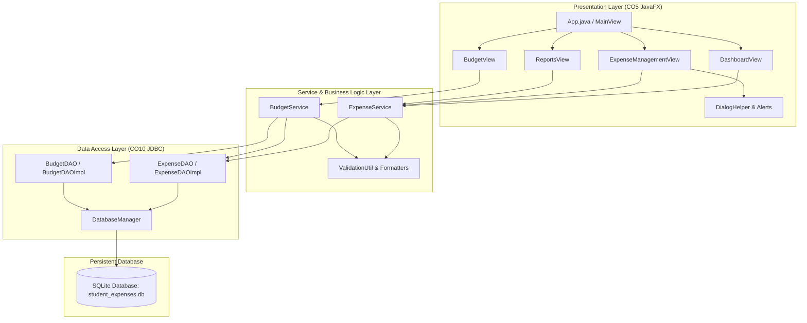

# 🎓 Student Expense Tracker

[](https://adoptium.net/)
[](https://openjfx.io/)
[](https://www.sqlite.org/)
[](https://maven.apache.org/)
[](LICENSE)

A modern, responsive, and robust desktop expense tracking application tailored for college students to monitor their daily spending habits, manage monthly financial budgets, and view visual analytics. 

Developed as a college mini project demonstrating both **CO5 (JavaFX Application Development and Event Handling)** and **CO10 (JDBC Database Connectivity and Event Handling Mechanisms using JDBC)**.

---

## 📑 Syllabus & Course Outcome (CO) Mapping

| Course Outcome | Focus Area | Application Implementation |
| :--- | :--- | :--- |
| **CO5** | **JavaFX Application Development & Event Handling** | <ul><li>Modular Stage, Scene, BorderPane, GridPane, VBox, HBox layouts</li><li>Rich controls: `TableView`, `TableColumn`, `DatePicker`, `ComboBox`, `TextField`, `TextArea`, `ProgressBar`</li><li>Interactive visualizations using `PieChart` and `BarChart`</li><li>Dynamic event listeners (`setOnAction`, `selectedItemProperty`, reactive text filter listeners)</li><li>Validation alerts and confirmation dialogs (`Alert.AlertType.CONFIRMATION`)</li><li>Custom soft lavender and bright white JavaFX CSS theme</li></ul> |
| **CO10** | **JDBC Database Connectivity & SQL Data Management** | <ul><li>Direct connection management using `DriverManager.getConnection()` and SQLite JDBC</li><li>Automatic DDL schema initialization (`CREATE TABLE IF NOT EXISTS`, indexing)</li><li>Full CRUD operations via parameterized `PreparedStatement` preventing SQL injection</li><li>Atomic multi-query transactions (`setAutoCommit(false)`, `commit()`, `rollback()`)</li><li>Clean resource lifecycle with `try-with-resources` ensuring zero memory/connection leaks</li><li>Persistent SQLite storage in standard user app data (`~/.student_expense_tracker/student_expenses.db`)</li><li>Decoupled DAO pattern (`ExpenseDAO`, `BudgetDAO`) separating DB logic from the UI</li></ul> |

---

## 🏛️ Architecture & System Design

The application follows an **Enterprise Multi-Tier Architecture** ensuring strict separation of concerns between presentation, business rules, and persistence:



### Architectural Highlights
1. **Presentation Layer (JavaFX)**: UI components bind reactively to domain data. Layouts automatically resize across different laptop screen resolutions.
2. **Service Layer**: Validates input constraints, handles calculations (e.g. remaining balance, budget utilization percentages, deficit tracking).
3. **DAO Layer (JDBC)**: Translates domain model objects (`Expense`, `Budget`) into parameterized SQL statements.
4. **Database (SQLite)**: Provides persistent, embedded local storage with zero server configuration needed.

---

## 🗄️ Database Schema & Design

The database schema is automatically provisioned on the very first launch by `DatabaseManager.initializeDatabase()`.

```sql
-- 1. Expenses Table
CREATE TABLE IF NOT EXISTS expenses (
    id INTEGER PRIMARY KEY AUTOINCREMENT,
    description TEXT NOT NULL,
    amount REAL NOT NULL CHECK(amount > 0),
    category TEXT NOT NULL,
    expense_date TEXT NOT NULL,
    payment_method TEXT NOT NULL,
    notes TEXT,
    created_at TIMESTAMP DEFAULT CURRENT_TIMESTAMP
);

CREATE INDEX IF NOT EXISTS idx_expense_date ON expenses(expense_date);
CREATE INDEX IF NOT EXISTS idx_expense_category ON expenses(category);

-- 2. Monthly Budgets Table
CREATE TABLE IF NOT EXISTS budgets (
    id INTEGER PRIMARY KEY AUTOINCREMENT,
    month_year TEXT NOT NULL UNIQUE,       -- Format: 'YYYY-MM', e.g. '2026-10'
    amount REAL NOT NULL CHECK(amount >= 0),
    updated_at TIMESTAMP DEFAULT CURRENT_TIMESTAMP
);
```

### Persistent File Location
- **Location**: `%USERPROFILE%\.student_expense_tracker\student_expenses.db` (Windows) or `~/.student_expense_tracker/student_expenses.db` (Linux/macOS).
- Existing records are **never lost** when the application closes or restarts.
- Automatic initial sample seeding is executed **only once** if the database contains zero records.

---

## ✨ Features Walkthrough

### 1. 📊 Interactive Dashboard
- **Summary Metric Cards**: Instant high-level view of Total Spent, Current Month Expenses, Today's Expenses, and Total Record Count.
- **Category Spending Breakdown**: JavaFX `PieChart` illustrating relative spending proportions.
- **Recent Transactions**: Quick-reference table showing the latest student expenditures.

### 2. 💳 Expense Management (Full CRUD)
- **Add Expense**: Record new expenses with description, amount, category, date picker, payment method, and optional notes.
- **View Expenses**: Responsive `TableView` with custom styled category badges (Food, Transport, Education, Shopping, Entertainment, Health, Others).
- **Update Expense**: Selecting any table row automatically populates the form for editing. Changes are saved back to SQLite using `PreparedStatement`.
- **Delete Expense**: Deletes selected record with a confirmation prompt (`Alert.AlertType.CONFIRMATION`).

### 3. 🔍 Real-Time Search & Multi-Filter
- **Keyword Search**: Instant search against expense descriptions and notes.
- **Category Filter**: Filter expenses by category (e.g., "Food", "Education").
- **Payment Method Filter**: Filter by UPI, Cash, Debit Card, Credit Card, or Net Banking.
- **Date Range Filter**: Filter between specific start and end dates.
- **Reset Button**: One-click filter reset.

### 4. 🎯 Monthly Budget & Overspending Warning
- **Budget Goal Setting**: Set or revise a target budget for any selected month (`YYYY-MM`).
- **Utilization Progress Bar**:
  - 🟢 **Safe (< 80%)**: Green progress with positive spending advice.
  - 🟡 **Warning (80% - 100%)**: Orange warning banner indicating budget is nearing capacity.
  - 🔴 **Exceeded (> 100%)**: Red alert banner highlighting exact overspent deficit.
- **Strict Financial Display Rule**: Negative remaining balance is **never** shown as available money; it is clearly marked as **Exceeded / Deficit**.

### 5. 📈 Analytical Reports
- **Standout Transaction Card**: Highlights the single most expensive transaction recorded.
- **Category Summary Table & PieChart**: Granular breakdown of expense count, total amount, and percentage share.
- **Monthly Trend Table & BarChart**: JavaFX `BarChart` comparing spending trends month over month.
- **Friendly Empty States**: Gracefully informs the student when no transactions exist instead of crashing.

---

## 🎨 UI Design System

- **Color Palette**: Bright white and soft lavender background (`#F8F9FE`), primary purple buttons (`#6C5CE7`), pastel blue cards (`#EBF2FF`), and subtle mint accents (`#00B894`).
- **Typography**: Modern typography utilizing system font fallbacks (`Segoe UI`, `SF Pro Display`, `sans-serif`).
- **Cards & Shadows**: Rounded corners (`14px`) with soft gaussian drop shadows for depth.
- **Responsive Layout**: Resizes fluidly across laptop screens without fixed coordinate clipping.

---

## 🛠️ Prerequisites & Installation

### Prerequisites
- **Java Development Kit (JDK)**: JDK 17 LTS or higher (e.g. Eclipse Temurin 17 / Oracle JDK 17).
- **Apache Maven**: Version 3.8+ (included or installed).
- **Operating System**: Windows 10/11, macOS, or Linux.

### Verifying Java and Maven
```bash
java -version
mvn -version
```

---

## 🚀 How to Run the Application

### Option 1: Run with Maven JavaFX Plugin (Recommended for Development)
```bash
mvn javafx:run
```

### Option 2: Run Using the Standalone Shaded Fat JAR
A standalone executable JAR containing all dependencies is packaged in `target/`:
```bash
# Build package (if needed)
mvn clean package -DskipTests

# Run the desktop JAR directly
java -jar target/student-expense-tracker-1.0.0.jar
```

### Option 3: Run Database Verification (Headless / Terminal Mode)
To verify database table creation and seeding without starting the JavaFX GUI:
```bash
java -cp target/student-expense-tracker-1.0.0.jar com.studentexpensetracker.database.DatabaseManager
```

---

## 🧪 Automated Testing

The project includes **24 automated unit and integration tests** built on JUnit 5. Every test runs against an isolated, temporary SQLite database to protect user data from deletion.

### Run All Tests
```bash
mvn test
```

### Test Coverage Summary
- `ValidationUtilTest` (9 tests): Validates description lengths, required fields, positive amounts, number formatting, and future date checks.
- `ExpenseDAOTest` (5 tests): Tests JDBC insertions, updates, deletions, multi-parameter search/filters, and SQL aggregations.
- `BudgetDAOTest` (3 tests): Tests budget persistence, upsert operations (`ON CONFLICT DO UPDATE`), and retrieval.
- `ExpenseServiceTest` (4 tests): Tests business logic rules, illegal argument handling, and dashboard metric calculations.
- `BudgetServiceTest` (3 tests): Tests under-budget calculations, near-budget warnings, and strictly verifies that overspent budgets never display negative available balances.

---

## 📁 Project Directory Structure

```text
student-expense-tracker/
├── pom.xml                                    # Maven configuration & dependencies
├── .gitignore                                 # Git ignore rules (build artifacts, DB files)
├── README.md                                  # Complete project documentation
├── DEMO_GUIDE.md                              # College viva & demonstration guide
├── src/
│   ├── main/
│   │   ├── java/
│   │   │   └── com/studentexpensetracker/
│   │   │       ├── Main.java                  # Standard JVM entry point
│   │   │       ├── App.java                   # JavaFX Application lifecycle
│   │   │       ├── model/                     # Domain & Data Transfer Models
│   │   │       │   ├── Expense.java           # Expense record model
│   │   │       │   ├── Budget.java            # Budget limit model
│   │   │       │   ├── BudgetStatus.java      # Budget calculation & deficit tracker
│   │   │       │   ├── DashboardMetrics.java  # Aggregation metrics model
│   │   │       │   ├── CategorySummary.java   # Category aggregation model
│   │   │       │   └── MonthlySummary.java    # Month aggregation model
│   │   │       ├── database/                  # SQLite JDBC Connection & DDL
│   │   │       │   ├── DatabaseConfig.java    # Persistent storage configuration
│   │   │       │   └── DatabaseManager.java   # Connection provider & table creation
│   │   │       ├── dao/                       # Data Access Object Layer (CO10)
│   │   │       │   ├── ExpenseDAO.java        # Expense DAO interface
│   │   │       │   ├── ExpenseDAOImpl.java    # JDBC implementation with PreparedStatements
│   │   │       │   ├── BudgetDAO.java         # Budget DAO interface
│   │   │       │   └── BudgetDAOImpl.java     # SQLite upsert implementation
│   │   │       ├── service/                   # Business Logic Layer
│   │   │       │   ├── ExpenseService.java    # Expense rules & query coordination
│   │   │       │   └── BudgetService.java     # Financial budget tracking
│   │   │       ├── util/                      # Utilities & Helpers
│   │   │       │   ├── ValidationUtil.java    # Input validation checks
│   │   │       │   ├── CurrencyUtil.java      # Monetary formatting (₹)
│   │   │       │   └── DateUtil.java          # Date & month-year formatters
│   │   │       └── ui/                        # JavaFX User Interface (CO5)
│   │   │           ├── MainView.java          # Root layout & tab coordinator
│   │   │           ├── NavigationBar.java     # Branded top navigation bar
│   │   │           ├── DashboardView.java     # Summary metrics cards & PieChart
│   │   │           ├── ExpenseManagementView.java # TableView, CRUD form & filters
│   │   │           ├── BudgetView.java        # Budget monitoring & progress bar
│   │   │           ├── ReportsView.java       # Analytical charts & summary tables
│   │   │           └── DialogHelper.java      # Standardized JavaFX Alert dialogs
│   │   └── resources/
│   │       └── css/
│   │           └── styles.css                 # Lavender & bright white stylesheet
│   └── test/
│       └── java/
│           └── com/studentexpensetracker/
│               ├── ValidationUtilTest.java    # Input validation unit tests
│               ├── ExpenseDAOTest.java        # JDBC integration tests
│               ├── BudgetDAOTest.java         # Budget database tests
│               ├── ExpenseServiceTest.java    # Expense business logic tests
│               └── BudgetServiceTest.java     # Budget warning & deficit tests
```

---

## 📸 Screenshots & Demonstration Preview

| View | Description | Preview |
| :--- | :--- | :--- |
| **Dashboard** | Metrics cards (Total, Today, Month, Records), PieChart breakdown, and recent transaction table. | *[View in Application]* |
| **Expense Management** | Full CRUD TableView with category badges, real-time search/filter bar, and add/edit form. | *[View in Application]* |
| **Monthly Budget** | Budget goal setting, utilization progress bar, safe/warning/danger alert banners. | *[View in Application]* |
| **Reports & Analytics** | Standout transaction card, category breakdown table, and monthly spending bar chart. | *[View in Application]* |

---

## 🔮 Future Scope & Enhancements

1. **Export Capabilities**: Export expense reports and monthly statements to PDF and CSV formats.
2. **Recurring Expenses**: Automatically schedule recurring monthly expenses (e.g. hostel rent, mess fees, mobile subscriptions).
3. **Receipt Attachment**: Allow students to attach photo receipts or invoices to expense transactions.
4. **Multi-Currency Support**: Dynamic currency switching (USD, EUR, GBP, INR) with live exchange rates.
5. **Role-Based Profiles**: Support multiple student profiles on a single shared computer.

---

## 📜 Academic Declaration

This project was built to demonstrate proficiency in:
- **CO5**: Designing responsive desktop interfaces, component hierarchies, and event-driven architecture using JavaFX.
- **CO10**: Database schema engineering, JDBC connection management, parameterized PreparedStatements, transaction processing, and exception handling.
